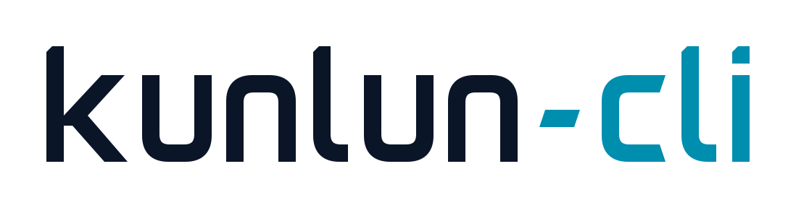

<h1 align="center">
  
  <picture>
    <source media="(prefers-color-scheme: dark)" srcset="https://raw.githubusercontent.com/lvshrd/kunlun_cli/main/asset/kunlun-wordmark-dark.svg">
    
  </picture>
</h1>

<p align="center">让本机 AI Agent 在你的身份和权限下，处理昆仑智联云文档与表格。</p>
<p align="center">
  <a href="https://www.npmjs.com/package/@lvshrd/kunlun-cli"></a>
</p>

用自然语言描述任务，Agent 通过 Skill 选择命令，kunlun-cli 负责授权、调用开放平台并返回可核对的结果。适用于能调用本机终端的 Agent；云端操作需要能访问昆仑平台的办公网络。

## 当前能力

下表对应 **0.2.3** 的实现；本机安装版本可用 `kunlun-cli --version` 查看。

| 能力 | 可以做什么 |
| --- | --- |
| 查找文档 | 按关键词搜索当前用户可见的文档，按完整标题唯一定位新版 DocX；同名时返回候选。搜索已完成接口适配与模拟测试，真实平台仍待验收。 |
| 阅读文档 | 通过 DocX 链接或 ID 读取正文、层级和版本，报告完整性及未展开内容，发现内嵌表格、画板等资源。 |
| 撰写与修改 | 从 Markdown 普通段落和一至三级标题创建文档、追加正文，替换单个文本片段中的唯一匹配内容；支持预览、版本检查与读回核对。 |
| 普通文档表格 | 在文档内创建带内容的表格，按矩阵读取和修改简单单元格文字。 |
| 电子表格 Sheets | 在文档内新建并嵌入电子表格，用 JSON 一次填入内容；查询工作表、读取指定区域、覆盖写入、插入追加和清空内容。 |
| 多维表格 Base | 在文档内新建并嵌入 Base，用 JSON 初始化文字/数字字段和记录，复用默认空白记录；查询数据表，增删改查记录，新增、修改及删除非主字段。 |
| 本机 Agent 集成 | 分发文档、表格及共享鉴权三个 Skill；本人浏览器授权、登录刷新、脱敏诊断，业务命令返回结构化 JSON。 |

当前文档正文写入以普通文字为主，复杂排版、正文评论、文档移动/重命名/删除尚未实现。普通表格限未合并、每格一个普通段落；创建最多 9×9，读取最多 81 格，修改最多 50 格。Sheets 暂不支持原生布尔值；Base 的 JSON 初始化只用于本次新建的数据表。跨表自动同步、表格行列结构调整和画板内容操作尚未实现。

## 工作原理

<p align="center">
  
</p>

图示展示调用与授权流程：Skill 提供操作指引，CLI 在本机执行命令，昆仑开放平台负责实际资源访问，执行结果返回本机 Agent。应用权限、本人授权和文档分享权限共同决定可操作范围。代码分层见[架构说明](https://github.com/lvshrd/kunlun_cli/blob/main/docs/ARCHITECTURE.md)。

## 安装与更新

需要 **Node.js 22.18+、npm**，支持 Windows、macOS 和 Linux。安装和更新使用同一条命令：

```sh
npm install --global @lvshrd/kunlun-cli@latest
kunlun-cli --version
```

PowerShell 若遇到脚本执行策略限制，使用 `kunlun-cli.cmd`。安装后找不到命令时，确认 npm 全局目录已加入 PATH，并重启终端与 Agent。离线安装和旧版迁移见[开发指南](https://github.com/lvshrd/kunlun_cli/blob/main/docs/DEVELOPMENT.md)。

## 首次使用

先向维护者领取批准使用的 App ID 和 Secret；也可以按[开发指南](https://github.com/lvshrd/kunlun_cli/blob/main/docs/DEVELOPMENT.md)配置自己的应用。然后在终端执行：

```sh
kunlun-cli config init
kunlun-cli skills install --dir .codex/skills
kunlun-cli auth login
```

`config init` 隐藏输入 Secret，请在本机终端输入；`auth login` 打开浏览器，由本人确认账号和授权。`.codex/skills` 是目录示例，需改为当前 Agent 实际发现技能的目录。三个 Skill 会一起安装，安装后开启新的 Agent 对话。

更新程序会保留应用配置和登录态。备份自行修改的 Skill 后，用 `skills install --dir <实际目录> --force` 同步技能；版本新增权限时，需重新 `auth login`。

## 使用

直接对 Agent 说：

- “使用 kunlun-doc，搜索标题包含‘周报’的文档，有同名时让我选。”
- “把这份草稿创建为昆仑云文档，读回核对后给我链接。”
- “把这篇文档中的‘每周检查一次’改成‘每天检查一次’，先给我看预览。”
- “使用 kunlun-tables，新建一篇项目台账文档，包含普通表格、电子表格和多维表格，并填入这份数据。”

也可直接运行 `kunlun-cli --help` 查看命令。[开发指南](https://github.com/lvshrd/kunlun_cli/blob/main/docs/DEVELOPMENT.md)包含源码复刻、命令参考、API 链接和扩展步骤。

读取结果会提示复杂内容是否完整；未展开内容不能视为不存在。写入超时或失败后，应先读回确认，避免重复创建或追加。表格写后核对不提供原子并发保护。

## 配置与排障

默认配置与登录态保存在 `~/.kunlun-cli`，可用 `KUNLUN_CONFIG_DIR` 隔离应用。Secret 和 token 当前保存在本地文件中，不要提交配置目录或把凭证发到对话。未配置网页根地址时，操作结果可能只返回 ID。

用 `config show`、`auth status` 查看脱敏状态，`doctor` 联网诊断，`auth logout` 退出。报障请提供版本、发生时间和脱敏错误。CLI 帮助、提示和错误消息使用英文，文档内容保留原语言。

## 许可证

本项目采用 [MIT 许可证](https://github.com/lvshrd/kunlun_cli/blob/main/LICENSE)，版权署名为 lvshrd。
